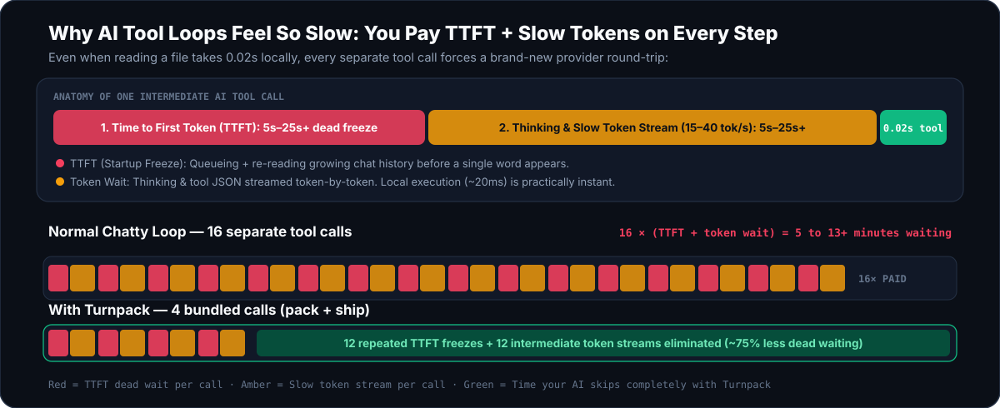

<div align="center">

<picture>
  <source media="(prefers-color-scheme: dark)" srcset="assets/hero-dark.svg" />
  <source media="(prefers-color-scheme: light)" srcset="assets/hero-light.svg" />
  
</picture>

<br /><br />

[](https://github.com/OnlyTerp/turnpack/actions/workflows/ci.yml)


**[See Why It Helps](#why-your-ai-feels-slow-in-plain-english)** · **[Watch 5-Second Demo](#watch-it-work-and-try-it-safely-in-5-seconds)** · **[60-Second Setup](#set-it-up-in-60-seconds)** · **[Time Saved Visualizer](#how-much-time-does-it-save)** · **[Safety & Security](#why-you-can-trust-it-on-real-projects)**

</div>

---

## Why Your AI Feels Slow (In Plain English)

Even the smartest coding AI spends most of its wall-clock time **waiting on Time-to-First-Token (`TTFT`) freezes and slow token streaming between tool calls**, not thinking once:

Every single time an AI searches one folder or opens one file by itself, you wait through **a full provider round-trip**:
- **Startup freeze (`TTFT`):** queuing + re-reading your growing chat history before a single token appears (`2s–25s+` depending on provider load, reasoning depth, and context length).
- **Token-by-token wait (`tok/s`):** streaming reasoning + tool JSON (`15–45 tok/s`), repeated over and over across 10–25 steps.
- **Half-edited breakage:** when an AI edits two files sequentially and tests fail, your repo stays broken while it burns even more slow turns undoing mistakes.

<picture>
  <source media="(prefers-color-scheme: dark)" srcset="assets/ttft-tax-dark.svg" />
  <source media="(prefers-color-scheme: light)" srcset="assets/ttft-tax-light.svg" />
  
</picture>

**Turnpack fixes the loop locally on your computer with 3 focused tools:**
- **`pack`** grabs searches, multiple file slices, globs, and git status together in one bounded step — while automatically hiding `.env` files and private keys.
- **`ship`** validates edits before writing, applies multi-file changes, runs your tests, and **automatically restores every file byte-for-byte** if a test fails.
- **`batch`** lets your AI filter or outline dozens of files in one quick read-only script instead of flooding your chat window.

<picture>
  <source media="(prefers-color-scheme: dark)" srcset="assets/how-it-works-dark.svg" />
  <source media="(prefers-color-scheme: light)" srcset="assets/how-it-works-light.svg" />
  
</picture>

---

## Watch It Work — and Try It Safely in 5 Seconds

Want to verify Turnpack **without touching a single file in your repo or changing any AI config**? Run the built-in sandbox walkthrough:

```bash
npx turnpack demo
```

It spins up a throwaway folder in your system temp directory, shows secret shielding, catches a failing test + proves byte-exact rollback, ships a verified multi-file edit, and cleans up automatically.

<div align="center">
  
</div>

---

## Set It Up in 60 Seconds

Run these two commands once (Node.js `22+` required, zero API keys):

```bash
npx turnpack init
npx turnpack doctor
```

`npx turnpack init` shows a readable preview of every config change first and saves `.turnpack.bak` backups before writing. It never injects rules into your `CLAUDE.md` or `AGENTS.md`, and `npx turnpack uninstall` removes only Turnpack entries.

<details>
<summary><strong>Click for per-app setup & manual copy-paste snippets (Claude Code, Codex, OMP, Cursor, Gemini CLI, OpenCode, Grok CLI)</strong></summary>

### Verified Tier-1 Auto-Setup (`npx turnpack init`)

- **Claude Code (`~/.claude.json`)**:
  ```json
  {
    "mcpServers": {
      "turnpack": {
        "command": "npx",
        "args": ["-y", "turnpack", "serve"]
      }
    }
  }
  ```
- **Codex CLI (`~/.codex/config.toml`)**:
  ```toml
  [mcp_servers.turnpack]
  command = "npx"
  args = ["-y", "turnpack", "serve"]
  ```
- **OMP / `oh-my-pi` (`~/.omp/agent/mcp.json` + optional cache-safe plugin)**:
  ```bash
  npx turnpack init --client omp --yes
  ```
  Installs both the MCP entry and the standalone `ExtensionAPI` plugin (`extensions/omp-turnpack.ts`), which never mutates system prompts or breaks prompt caching.

### Experimental MCP-Only Auto-Setup (`--experimental`) or Copy-Paste

```bash
# Registers only the MCP server entry without altering host hook dialects:
npx turnpack init --client cursor --experimental --yes
npx turnpack init --client gemini --experimental --yes
npx turnpack init --client opencode --experimental --yes
npx turnpack init --client grok --experimental --yes
```

See [docs/harness-matrix.md](docs/harness-matrix.md) for exact file paths, framing support, and client inline caps.

</details>

---

## How Much Time Does It Save?

The slower your provider's **Time-to-First-Token (`TTFT`)** or **token output speed (`tok/s`)**, the bigger difference fewer round-trips makes. Every skipped turn avoids another `TTFT` startup freeze plus another token-streaming wait:

<picture>
  <source media="(prefers-color-scheme: dark)" srcset="assets/time-saved-dark.svg" />
  <source media="(prefers-color-scheme: light)" srcset="assets/time-saved-light.svg" />
  
</picture>

| Provider Latency Profile *(16 turns → 4 turns)* | 1 Turn (`TTFT + token stream`) | Single-Task Wait (`Before → After`) | Weekly Saved (`20 tasks/d, 5d/wk`) |
| :--- | :--- | :--- | ---: |
| **Fast / Warm-Cache API** | `2s TTFT + 5s @ 45 tok/s = 7s` | `~1m 52s` → `~28s` (**save `~1m 24s`**) | **`~2.3 hrs / week`** |
| **Frontier Reasoning Model** | `6s TTFT + 12s @ 30 tok/s = 18s` | `~4m 48s` → `~1m 12s` (**save `~3m 36s`**) | **`~6.0 hrs / week`** |
| **High-TTFT / Deep Thinking / Busy API** | `15s TTFT + 20s @ 20 tok/s = 35s` | `~9m 20s` → `~2m 20s` (**save `~7m 00s`**) | **`~11.7 hrs / week`** |
| **Slow-Prefill / Local 70B+ GPU** | `25s TTFT + 25s @ 18 tok/s = 50s` | `~13m 20s` → `~3m 20s` (**save `~10m 00s`**) | **`~16.7 hrs / week`** |

- **Plug in your own TTFT & `tok/s` in your terminal:**
  ```bash
  npx turnpack estimate --profile high-ttft
  npx turnpack estimate --ttft 15 --tok-per-turn 400 --tps 20
  ```
- **Open the interactive visual slider page:** [docs/calculator.html](docs/calculator.html) *(and exact formula in [docs/time-calculator.md](docs/time-calculator.md))*

### Measured Local Engine Overhead (42-File Fixture, Node v24.16.0)

These are **real measured local execution timings** from `node bench/run-local-bench.mjs` and `npx turnpack doctor --json` *(not synthetic AI benchmark claims — see [bench/README.md](bench/README.md) for our 3-arm LLM eval protocol)*:

| Check / Operation | Measured Result | What It Means for You |
| :--- | ---: | :--- |
| **`tools/list` schema footprint** | `3,289` bytes (`~823` tokens) | Minimal context tax across all 3 tools (`pack`, `ship`, `batch`) |
| **MCP stdio handshake + probe** | `54 ms` | Instant local startup, zero remote network hops |
| **`pack` median (search + 4 files + `.env` block)** | `19.4 ms` | Gathers multi-file context faster than a single keystroke |
| **`batch` median (read-only outline across 40 files)** | `20.7 ms` | Inspects structure locally without flooding chat history |
| **`ship` median (2-file edit + `node` verify)** | `62.9 ms` | Snapshots, applies edits, verifies, or rewinds before stale state sticks |

---

## Why You Can Trust It on Real Projects

| Guardrail | Default Behavior | Why It Matters |
| :--- | :--- | :--- |
| **Secret Shield** | Redacts `.env`, `.env.*` (keeps `.env.example`), `*.pem`, `*.key`, `id_rsa`/`id_ed25519`, `.npmrc`, `.netrc`, `credentials.json` unless `allow_secrets: true` | Your AI never accidentally dumps live API keys into cloud context |
| **Workspace Jail** | Resolves symlinks via `fs.realpathSync` and blocks traversal or cross-drive paths outside your project folder | AI edits cannot wander outside your repo |
| **Read-Only `batch`** | Shell `exec`, filesystem writes, and `fetch` are disabled unless `TURNPACK_ALLOW_EXEC=1` | Programmatic inspection stays predictable without silent command execution |
| **Honest Rollback Status** | Reports `SHIPPED_AND_VERIFIED`, `FAILED_AND_ROLLED_BACK`, `FAILED_ROLLBACK_PARTIAL` (with file errors), or `FAILED_KEPT_ON_DISK` | You always know the exact state on disk if verification fails |
| **Zero Dependencies** | `"dependencies": {}` in `package.json`, strict TypeScript (`strict: true`, `noUncheckedIndexedAccess: true`), CI across Windows/macOS/Linux | Zero transitive dependency bloat and full Windows support without WSL |

See [SECURITY.md](SECURITY.md) for the complete threat model and optional `.turnpack.json` verify command allowlist.

---

## When You Don't Need Turnpack

- **One-line typo in a file you already have open:** Just use your editor or a single direct edit — there are no extra turns to collapse.
- **Whole-repo Markdown dumps for browser chat:** Use [Repomix](https://github.com/yamadashy/repomix) for full-repo snapshots. Turnpack focuses on task-scoped slices and test-gated local edits.

---

## Prior Art, Recipes & Links

Turnpack builds cleanly on ideas popularized by **Anthropic's Programmatic Tool Calling**, **Cloudflare Code Mode**, [`context-mode`](https://github.com/mksglu/context-mode), **Repomix**, and **Serena**, focusing on an ultra-small MIT-licensed 3-tool MCP server paired with test-gated preimage rollback.

- [Interactive Time Calculator & Setup Generator](docs/calculator.html)
- [Harness Compatibility Matrix](docs/harness-matrix.md)
- [Recipes (Multi-file Rename, Verify Allowlist, Native Windows, When Not to Use)](docs/recipes/01-multi-file-rename.md)
- [Benchmark Protocol & Local Runner](bench/README.md)
- [Security Policy](SECURITY.md) · [Contributing](CONTRIBUTING.md) · [Changelog](CHANGELOG.md)

<div align="center">
  <sub>MIT License · Built by <a href="https://github.com/OnlyTerp">OnlyTerp</a></sub>
</div>
