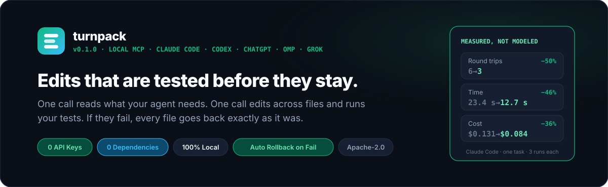
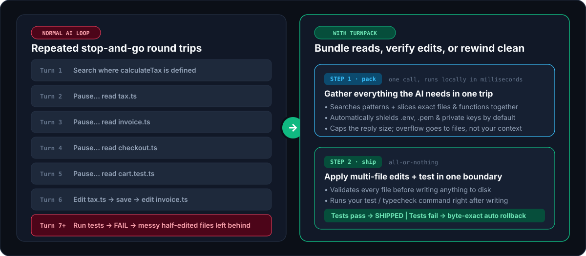
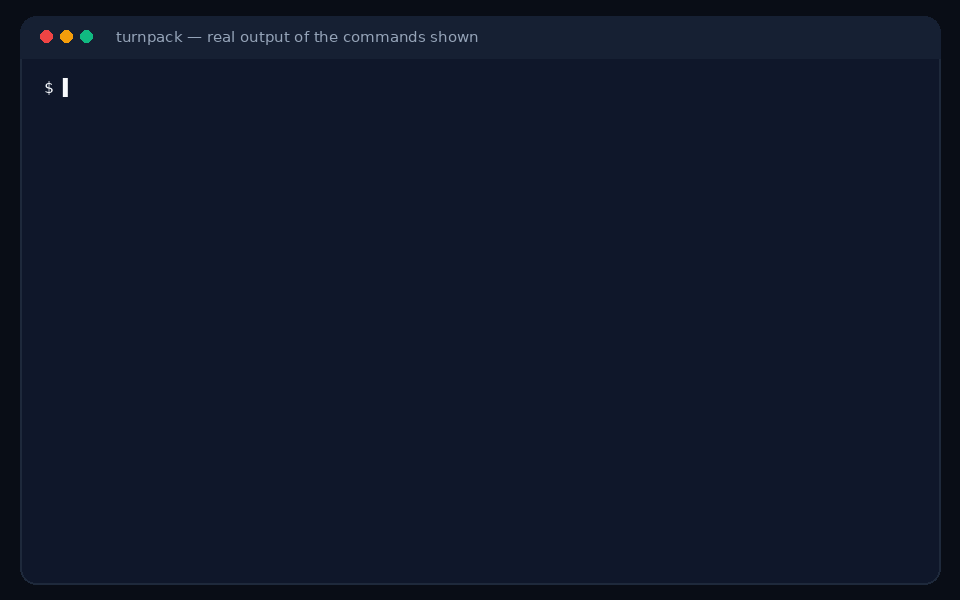
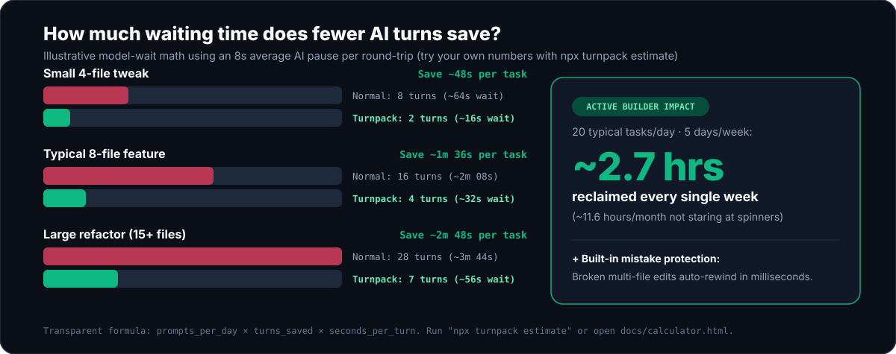

<div align="center">

<picture>
  <source media="(prefers-color-scheme: dark)" srcset="assets/hero-dark.svg" />
  <source media="(prefers-color-scheme: light)" srcset="assets/hero-light.svg" />
  
</picture>

<br /><br />

[](https://github.com/OnlyTerp/turnpack/actions/workflows/ci.yml)


**[Try the demo](#try-it-in-10-seconds)** · **[See an example](#what-it-looks-like)** · **[Set it up](#set-it-up)** · **[The three tools](#the-three-tools)** · **[Time saved](#how-much-time-does-it-save)** · **[Safety](#safety)** · **[FAQ](#faq)**

</div>

---

AI coding agents work in round trips. Reading a file is one trip. A search is another. Editing two files and running the tests is three more. Each trip is a full model turn: a wait for the first token, then the tokens themselves. And when the tests fail at the end, your repo is left half-edited while the agent spends more turns backing out.

Turnpack is a small local [MCP](https://modelcontextprotocol.io) server that gives the agent three tools to fold those trips together:

| Tool | One call does | So that |
| :--- | :--- | :--- |
| **`pack`** | A regex search, several files (whole, by line range, or just one function), glob listings and git status | The agent gets its context in one turn. Replies are size-capped, and `.env` and key files are redacted. |
| **`ship`** | Edits across any number of files, then your test command | Either everything passes and stays, or every file is restored byte-for-byte and the agent gets the failing output. |
| **`batch`** | A short read-only script over the repo | "Which of these 40 files export X?" costs one turn and a ten-line answer instead of 40 reads. |

It runs entirely on your machine: no API keys, no account, no telemetry, no network calls, and zero runtime dependencies. It works with Claude Code, Codex CLI, OMP, Cursor, Gemini CLI, OpenCode and anything else that speaks MCP over stdio.

<picture>
  <source media="(prefers-color-scheme: dark)" srcset="assets/how-it-works-dark.svg" />
  <source media="(prefers-color-scheme: light)" srcset="assets/how-it-works-light.svg" />
  
</picture>

## Try it in 10 seconds

```bash
npx turnpack demo
```

This builds a throwaway repo in your temp folder, runs all three tools against it, and deletes it. Nothing in your own projects or AI app config is touched.

<div align="center">
  
</div>

The recording is generated from the real output of those two commands ([`scripts/render-assets.py`](scripts/render-assets.py)), so it cannot drift from what the tool does.

Want to run it straight from this repository instead of npm? `npx github:OnlyTerp/turnpack demo`

## What it looks like

A rename that misses a call site is the classic way an agent breaks a build. Here is that mistake going through `ship`. The agent renames a function but forgets the file that imports it:

```json
{
  "edits": [
    { "path": "src/tax.js", "search": "export function calculateTax(amount)", "replace": "export function computeTax(amount)" }
  ],
  "verify": "npm test"
}
```

```text
FAILED_AND_ROLLED_BACK: verify "npm test" failed (exit code 1).

Restored 1 file(s) to byte-exact pre-edit snapshots. The workspace is unchanged; fix the edit and ship again.

$ npm test
> test
> node test/invoice.test.js

file:///home/you/shop/src/invoice.js:1
import { calculateTax } from "./tax.js";
         ^^^^^^^^^^^^
SyntaxError: The requested module './tax.js' does not provide an export named 'calculateTax'
```

The repo is exactly as it was, and the agent has the error that tells it what it missed. It ships again with both files:

```json
{
  "edits": [
    { "path": "src/tax.js", "search": "export function calculateTax(amount)", "replace": "export function computeTax(amount)" },
    { "path": "src/invoice.js", "search": "calculateTax", "replace": "computeTax", "replace_all": true }
  ],
  "verify": "npm test"
}
```

```text
SHIPPED_AND_VERIFIED in 170ms: 2 file(s) changed (src/tax.js, src/invoice.js).

$ npm test  (passed)
> test
> node test/invoice.test.js

ok - invoice total includes tax
```

Two turns, and at no point was the working tree broken. Both replies are real output, with Node's internal stack frames cut from the first and the project path shortened.

<details>
<summary><strong>And the <code>pack</code> call that came before it</strong></summary>

```json
{
  "query": "calculateTax",
  "files": ["src/tax.js", { "path": "src/invoice.js", "symbol": "invoiceTotal" }, ".env"],
  "git_status": true
}
```

```text
## GIT STATUS
## master

## SEARCH "calculateTax" (3 hits, engine=rg)
src/invoice.js:1: import { calculateTax } from "./tax.js";
src/invoice.js:4:   return Number((subtotal + calculateTax(subtotal)).toFixed(2));
src/tax.js:3: export function calculateTax(amount) {

## FILES (3)
### FILE: src/tax.js (L1-6/6)
1 | export const TAX_RATE = 0.08;
2 |
3 | export function calculateTax(amount) {
4 |   return Number((amount * TAX_RATE).toFixed(2));
5 | }
6 |

### SYMBOL: src/invoice.js :: function invoiceTotal (L3-5/6)
3 | export function invoiceTotal(subtotal) {
4 |   return Number((subtotal + calculateTax(subtotal)).toFixed(2));
5 | }

### FILE: .env
[REDACTED SECRET FILE: .env — pass allow_secrets: true if intentional]
```

</details>

## Set it up

You need Node.js 22 or newer. Then:

```bash
npx turnpack init
```

```bash
npx turnpack doctor
```

`init` finds the AI apps you have installed, shows you exactly what it would change, and asks before writing. It saves a `.turnpack.bak` copy of every file it edits, and it leaves any config it cannot parse untouched. It never adds rules to your `CLAUDE.md` or `AGENTS.md`. `npx turnpack uninstall` removes only what `init` added. Restart your AI app afterwards so it loads the server.

<details>
<summary><strong>Manual setup and per-app snippets</strong></summary>

**Claude Code** — one command:

```bash
claude mcp add --scope user turnpack -- npx -y turnpack serve
```

or add this to `~/.claude.json` (this is what `init` writes):

```json
{
  "mcpServers": {
    "turnpack": { "command": "npx", "args": ["-y", "turnpack", "serve"] }
  }
}
```

**Codex CLI** — `~/.codex/config.toml`:

```toml
[mcp_servers.turnpack]
command = "npx"
args = ["-y", "turnpack", "serve"]
```

**OMP (`oh-my-pi`)** — `~/.omp/agent/mcp.json`, plus an optional status-line extension:

```bash
npx turnpack init --client omp --yes
```

**Cursor, Gemini CLI, OpenCode, Grok CLI** — `init` writes only the MCP server entry for these, and only when you name them:

```bash
npx turnpack init --client cursor --yes
```

```bash
npx turnpack init --experimental --yes
```

Config paths, inline size caps and status per app are in [docs/harness-matrix.md](docs/harness-matrix.md).

</details>

Turnpack tells the agent when to use its tools through the MCP `instructions` field, which is about 170 tokens of static text. If your agent still reaches for one-file-at-a-time tools, [docs/steering.md](docs/steering.md) has an optional snippet for your rules file and an optional Claude Code hook.

## The three tools

### `pack`: gather context in one call

| Argument | What it does |
| :--- | :--- |
| `query`, `literal` | Search the repo with a regex, or plain text. Uses ripgrep when installed, a built-in search otherwise. |
| `files` | `"src/app.ts"`, `"src/app.ts:10-80"`, or `{ "path": "src/app.ts", "symbol": "handleLogin" }` to slice out one function or class (JS/TS, Python, Rust, Go). |
| `globs` | List matching paths, for example `"src/**/*.test.ts"`. |
| `git_status` | Include `git status --short --branch`. |
| `max_bytes`, `inline_only` | Reply size cap (4,000–44,000 bytes, set per app by default). What fits is returned inline; overflow goes to private files outside your repo that the agent reads only if it needs them. |

### `ship`: edit, test, and undo if it fails

| Argument | What it does |
| :--- | :--- |
| `edits` | Exact search-and-replace. Each `search` must match once (or pass `replace_all`). Line endings are matched for you, so LF anchors work on CRLF files. |
| `writes`, `deletes` | Create, replace or delete whole files, so a file move ships as one change. |
| `verify` | One or more commands that must exit 0, for example `"npm test"` or `["tsc --noEmit", "npm test"]`. |
| `rollback_on_fail` | Defaults to `true`. |

Every edit is checked before anything is written: a missing or ambiguous anchor in file five means files one to four are never touched. The reply always starts with what is true on disk now:

`SHIPPED_AND_VERIFIED` · `APPLIED_NO_VERIFY` · `ABORTED_BEFORE_WRITE` · `FAILED_AND_ROLLED_BACK` · `FAILED_ROLLBACK_PARTIAL` · `FAILED_KEPT_ON_DISK`

When verify fails, the agent gets the beginning and the end of the output, because test failures are reported at the end. When it passes, it gets a few lines, because nobody needs 800 lines of green.

### `batch`: one script instead of forty reads

```js
// Which source files still import the old module, and how many functions does each have?
const hits = await ctx.grep("from \"./legacy", { literal: true });
const files = [...new Set(hits.map((h) => h.relPath))];
return files.map((f) => ({ file: f, functions: ctx.outline(f).length }));
```

The script gets `ctx.files(glob)`, `ctx.read(path, start, end)`, `ctx.outline(path)`, `await ctx.grep(pattern)` and `await ctx.gitStatus()`. It cannot write files, start processes, or see your environment variables. See [Safety](#safety) for how that is enforced.

## How much time does it save?

It depends on how many round trips your agent was making, and we have not published a model-in-the-loop benchmark yet. What we can give you is the arithmetic and a way to plug in your own numbers:

```text
time saved per task = round trips avoided × (time to first token + tokens per turn ÷ tokens per second)
```

<picture>
  <source media="(prefers-color-scheme: dark)" srcset="assets/time-saved-dark.svg" />
  <source media="(prefers-color-scheme: light)" srcset="assets/time-saved-light.svg" />
  
</picture>

The chart models one scenario, a task that would take 16 round trips done in 4, across five latency profiles:

| Latency profile | One turn | 16 turns | 4 turns |
| :--- | :--- | ---: | ---: |
| Local GPU, warm cache | 0.5s to first token + 330 tokens at 30/s = 11.5s | 3m 04s | 46s |
| Fast cloud API | 2s + 225 tokens at 45/s = 7s | 1m 52s | 28s |
| Frontier reasoning model | 6s + 360 tokens at 30/s = 18s | 4m 48s | 1m 12s |
| Busy or cold-cache API | 15s + 400 tokens at 20/s = 35s | 9m 20s | 2m 20s |

Read it with these in mind:

- **The turn counts are an assumption, not a measurement.** Agents that already issue tool calls in parallel make fewer round trips for reads to begin with. With those, expect less from `pack` and most of the gain from `ship`, because no built-in tool edits, tests and rolls back in one turn.
- **The latency numbers are examples.** Yours are easy to measure, and both the CLI and the [interactive calculator](docs/calculator.html) take them as input:

  ```bash
  npx turnpack estimate --ttft 2 --tok-per-turn 300 --tps 40
  ```

- **It does not count** the turns an agent spends repairing a half-applied edit, which is the cost `ship` exists to remove.

The formula and every default are written out in [docs/time-calculator.md](docs/time-calculator.md). The protocol for a real benchmark (native tools, native tools plus a batching prompt, and native tools plus Turnpack, on the same model and tasks) is in [bench/README.md](bench/README.md). If you run it, please open an issue with the results, including the ones that show no gain.

### What Turnpack itself costs

These are measured, by `npm run bench` and `npx turnpack doctor --json` on Linux x64 with Node 22.23:

| | Measured | Notes |
| :--- | ---: | :--- |
| Tool schema in your context | 4,502 bytes, about 1,100 tokens | All three tools, plus about 170 tokens of instructions |
| Server start and handshake | about 50 ms | Local stdio, no network |
| `pack`: a search, four files and a blocked `.env` | 7 ms median | 42-file fixture |
| `ship`: a two-file edit and a `node` verify | 36 ms median | Dominated by starting the verify command |
| `batch`: outline 40 files | 81 ms median | Most of it is starting the isolated process |

## Safety

An agent that can edit files and run commands deserves fences. These are the ones Turnpack puts up, and where each one ends.

| Fence | What it does | Where it ends |
| :--- | :--- | :--- |
| **Workspace jail** | The workspace is fixed by the server, not by the model: `TURNPACK_ROOT`, else the folders your app reports over MCP `roots`, else `CLAUDE_PROJECT_DIR`, else the directory the server started in. A tool call can pick a subdirectory and nothing else. Symlinks are resolved before the check. | If your app starts the server in your home directory and names no project, your home directory is the workspace. Set `TURNPACK_ROOT` to be explicit. |
| **Secret shield** | `.env*`, private keys, `.npmrc`, cloud credentials, Terraform state and [similar files](SECURITY.md) are redacted from `pack` and `batch` and refused by `ship`. | It matches file names, not contents, and the agent can pass `allow_secrets`. It prevents accidents; it is not a vault. |
| **Read-only `batch`** | The script runs in a separate process started under Node's permission model: no file writes, no child processes, no workers, reads limited to the workspace. It is handed no host objects and none of your environment variables, and it is killed at its time limit. | Node's permission model does not restrict network access on Node 22. `TURNPACK_ALLOW_EXEC=1` turns `ctx.exec` on and the read-only promise off. |
| **Protected paths** | `ship` never writes `.turnpack.json` or anything under `.git/`, so an edit cannot switch off the allowlist or plant a git hook. | |
| **Verify allowlist** | Optional. With `{"enforceVerifyAllowlist": true, "allowedVerify": ["npm test"]}` in `.turnpack.json`, `ship` runs only those commands, with plain arguments and no shell operators. A broken config file blocks verify rather than disabling the list. | The command runs your project's code, and `ship` edits your project's code. It limits what can be launched, not what your tests do. |
| **Rollback** | Byte-exact snapshots taken before the first write, restored when verify fails or times out, and when the server receives SIGINT or SIGTERM mid-verify. New files and the directories created for them are removed. | Snapshots live in memory, so `kill -9` or a power cut mid-verify leaves the edits in place. Side effects of the verify command itself (a migrated database, generated files) are not undone. Keep using git. |
| **Zero dependencies** | `"dependencies": {}`. The whole server is the TypeScript in `src/`. | |

Each fence has tests that attack it: sandbox escapes, path traversal, symlink escapes, allowlist smuggling, argument injection, rollback under a kill signal. They are in [`test/`](test), and `npx turnpack doctor` re-checks the main ones on your machine. The full threat model is in [SECURITY.md](SECURITY.md).

## When you don't need it

- **A one-line fix in a file the agent already has open.** One edit is one edit; there is nothing to fold.
- **Pasting a whole repository into a chat window.** That is what [Repomix](https://github.com/yamadashy/repomix) is for. Turnpack is for an agent working inside a repo, a slice at a time.
- **A project with no fast check.** `ship` earns its keep when a test, type check or build takes seconds. Without a `verify` it is a multi-file edit with validation and nothing more.

## FAQ

**My agent already reads several files in parallel. What does `pack` add?**
Less than it would for an agent that does not. Parallel calls remove round trips for reads the model already knows it wants. `pack` also merges the search that finds those files with the reads, caps the reply size, and redacts secrets, and it behaves the same in apps that do not parallelize. If your agent batches reads well, you will mostly notice `ship`.

**Will the model actually use these tools?**
Usually, not always. The server describes when to use each tool in its MCP instructions, and current models follow that most of the time. How often depends on the model and the app, and we have no measured number to give you. [docs/steering.md](docs/steering.md) covers the optional ways to push harder.

**Why not `git stash` or `git checkout` to roll back?**
`ship` works without git, never touches your index, staging area or unrelated uncommitted changes, restores only the files it changed, and removes the files it created.

**Is `batch` a sandbox?**
It is two layers. The script gets a tiny API and no host objects, and it runs in a process that Node itself refuses to let write, spawn or read outside the workspace. Node documents its permission model as a safety net against trusted code doing something unintended rather than a defence against deliberately malicious code, and we describe ours the same way. [SECURITY.md](SECURITY.md) says exactly what is and is not blocked.

**Does it send anything anywhere?**
No. There is no network code in the server. `ship` runs the verify command you or the agent names, and that command can do whatever your shell can.

**Does it work on Windows?**
Yes, natively. CI runs the full suite on Windows, macOS and Linux. Timed-out verify commands are stopped with `taskkill /T`, and paths are checked across drive letters.

## Prior art

Turnpack builds on ideas from Anthropic's programmatic tool calling, Cloudflare's Code Mode, [`context-mode`](https://github.com/mksglu/context-mode), [Repomix](https://github.com/yamadashy/repomix) and [Serena](https://github.com/oraios/serena). Its own angle is narrow: three tools, a small schema, and edits that are tested before they are allowed to stay.

## More

- [Recipes](docs/recipes/01-multi-file-rename.md): multi-file rename, verify allowlist, native Windows, when not to use it
- [Steering your agent toward the tools](docs/steering.md)
- [App compatibility matrix](docs/harness-matrix.md)
- [Time model and calculator](docs/time-calculator.md) · [interactive version](docs/calculator.html)
- [Benchmark protocol](bench/README.md)
- [Security policy](SECURITY.md) · [Contributing](CONTRIBUTING.md) · [Changelog](CHANGELOG.md)

<div align="center">
  <sub>MIT License · Built by <a href="https://github.com/OnlyTerp">OnlyTerp</a></sub>
</div>
