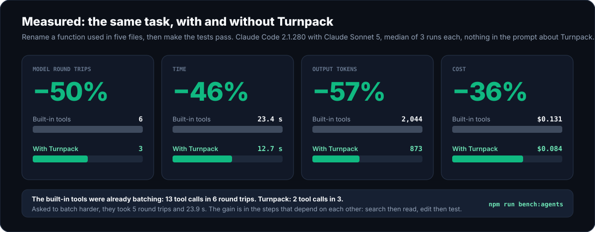

<div align="center">

<picture>
  <source media="(prefers-color-scheme: dark)" srcset="assets/hero-dark.svg" />
  <source media="(prefers-color-scheme: light)" srcset="assets/hero-light.svg" />
  
</picture>

<br /><br />

[](https://github.com/OnlyTerp/turnpack/actions/workflows/ci.yml)
[](#how-much-does-it-save)


**[Try the demo](#try-it-in-10-seconds)** · **[See an example](#what-it-looks-like)** · **[Set it up](#set-it-up)** · **[The three tools](#the-three-tools)** · **[What it saves](#how-much-does-it-save)** · **[Safety](#safety)** · **[FAQ](#faq)**

</div>

---

<!--
LAUNCH FILM (not added yet, so nothing renders here).
To add it: open this file in the editor on github.com, click the empty line under this comment, and drag
turnpack-readme-720p.mp4 onto it. GitHub uploads the file and writes its URL on that line, and that URL
renders as an inline video player. Then remove the comment markers around the caption below.
-->

<!--
<p align="center"><sub>The same rename, done one tool call per turn in nine turns and with Turnpack in three. The nine-turn loop is an illustration: today's apps batch some of those calls, and in <a href="#how-much-does-it-save">a measured run</a> Claude Code needed six round trips without Turnpack and three with it. The film closes on those measured numbers. The Turnpack calls and replies are the real ones from <a href="#what-it-looks-like">the example below</a>.</sub></p>
-->

<picture>
  <source media="(prefers-color-scheme: dark)" srcset="assets/measured-dark.svg" />
  <source media="(prefers-color-scheme: light)" srcset="assets/measured-light.svg" />
  
</picture>

<p align="center"><sub>Drawn from the recorded runs in <a href="bench/results/2026-11-13-claude-code.json"><code>bench/results</code></a>. One small task, three runs per arm: <a href="#how-much-does-it-save">what that does and does not show</a>.</sub></p>

AI coding agents work in round trips: the model asks for something, waits, reads the result, and asks again. Each trip is a full model turn, a wait for the first token and then the tokens themselves. Today's apps already run independent reads side by side, so the trips that are left are the ones that depend on each other. A search has to come back before the agent knows which files to open. An edit has to land before the tests can run. And when the tests fail at the end, your repo is left half-edited while the agent spends more turns backing out.

Turnpack is a small local [MCP](https://modelcontextprotocol.io) server that gives the agent three tools to fold those trips together:

| Tool | One call does | So that |
| :--- | :--- | :--- |
| **`pack`** | A regex search with the code around each hit, several files (whole, by line range, or just one function), glob listings and git status | The agent gets its context in one turn. Replies are size-capped, and `.env` and key files are redacted. |
| **`ship`** | Edits across any number of files, then your test command | Either everything passes and stays, or every file is restored byte-for-byte and the agent gets the failing output. None of the four apps we checked does this on its own. |
| **`batch`** | A short read-only script over the repo | "Which of these 40 files export X?" costs one turn and a ten-line answer instead of 40 reads. |

It runs entirely on your machine: no API keys, no account, no telemetry, no network calls, and zero runtime dependencies. It works with Claude Code and Claude Desktop, Codex CLI and the ChatGPT desktop app, OMP, Grok Build, Cursor, Gemini CLI, OpenCode and anything else that speaks MCP over stdio.

<picture>
  <source media="(prefers-color-scheme: dark)" srcset="assets/how-it-works-dark.svg" />
  <source media="(prefers-color-scheme: light)" srcset="assets/how-it-works-light.svg" />
  
</picture>

<p align="center"><sub>Both columns are the tool calls of those same recorded runs, not an illustration.</sub></p>

## Try it in 10 seconds

```bash
npx turnpack demo
```

This builds a throwaway repo in your temp folder, runs all three tools against it, and deletes it. Nothing in your own projects or AI app config is touched.

<div align="center">
  
</div>

The recording is generated from the real output of those two commands ([`scripts/render-assets.py`](scripts/render-assets.py)), so it cannot drift from what the tool does. `doctor` is run on a temporary home directory in which `init` has just set up five apps, which is why it lists them.

Want to run it straight from this repository instead of npm? `npx github:OnlyTerp/turnpack demo`

## What it looks like

A rename that misses a call site is the classic way an agent breaks a build. Here is that mistake going through `ship`. The agent renames a function but forgets the file that imports it:

```json
{
  "edits": [
    {
      "path": "src/tax.js",
      "search": "export function calculateTax(amount)",
      "replace": "export function computeTax(amount)"
    }
  ],
  "verify": "npm test"
}
```

```text
FAILED_AND_ROLLED_BACK: verify "npm test" failed (exit code 1).

Restored 1 file(s) to byte-exact pre-edit snapshots. The workspace is unchanged; fix the edit and ship again.

$ npm test
> test
> node test/invoice.test.js

file:///home/you/shop/src/invoice.js:1
import { calculateTax } from "./tax.js";
         ^^^^^^^^^^^^
SyntaxError: The requested module './tax.js' does not provide an export named 'calculateTax'
```

The repo is exactly as it was, and the agent has the error that tells it what it missed. It ships again with both files:

```json
{
  "edits": [
    {
      "path": "src/tax.js",
      "search": "export function calculateTax(amount)",
      "replace": "export function computeTax(amount)"
    },
    {
      "path": "src/invoice.js",
      "search": "calculateTax",
      "replace": "computeTax",
      "replace_all": true
    }
  ],
  "verify": "npm test"
}
```

```text
SHIPPED_AND_VERIFIED in 170ms: 2 file(s) changed (src/tax.js, src/invoice.js).

$ npm test  (passed)
> test
> node test/invoice.test.js

ok - invoice total includes tax
```

Two turns, and at no point was the working tree broken. Both replies are real output, with Node's internal stack frames cut from the first and the project path shortened.

<details>
<summary><strong>And the <code>pack</code> call that came before it</strong></summary>

```json
{
  "query": "calculateTax",
  "files": ["src/tax.js", { "path": "src/invoice.js", "symbol": "invoiceTotal" }, ".env"],
  "git_status": true
}
```

```text
## GIT STATUS
## master

## SEARCH "calculateTax" (3 hits, engine=rg)
src/invoice.js:1: import { calculateTax } from "./tax.js";
src/invoice.js:4:   return Number((subtotal + calculateTax(subtotal)).toFixed(2));
src/tax.js:3: export function calculateTax(amount) {

## FILES (3)
### FILE: src/tax.js (L1-6/6)
1 | export const TAX_RATE = 0.08;
2 |
3 | export function calculateTax(amount) {
4 |   return Number((amount * TAX_RATE).toFixed(2));
5 | }
6 |

### SYMBOL: src/invoice.js :: function invoiceTotal (L3-5/6)
3 | export function invoiceTotal(subtotal) {
4 |   return Number((subtotal + calculateTax(subtotal)).toFixed(2));
5 | }

### FILE: .env
[REDACTED SECRET FILE: .env — pass allow_secrets: true if intentional]
```

</details>

## Set it up

You need Node.js 22 or newer. Then:

```bash
npx turnpack init
```

```bash
npx turnpack doctor
```

`init` finds the AI apps you have installed, shows you exactly what it would change, and asks before writing. By default that is Claude Code, Claude Desktop, Codex (the CLI and the ChatGPT desktop app share one config), OMP and Grok Build.

- **The entry it writes starts a file on your machine, with an absolute path to Node.** That starts in tens of milliseconds, works offline, cannot change version without you, and does not depend on the `PATH` a desktop app happens to be given. If you ran `init` through `npx`, the server's files are first copied to `~/.turnpack/versions/<version>`, because the `npx` cache gets cleaned. Prefer a portable entry? `init --npx` writes `npx -y turnpack@<version> serve` instead, pinned to the version.
- **It then starts the server with that exact command** and tells you whether it answered. An entry in a config file and an entry that works are different things.
- **It is careful with your files.** Every file it edits gets a `.turnpack.bak` copy, anything you added to an existing entry is kept, a config it cannot parse is left untouched, and the file's own indentation and line endings are preserved. It never adds rules to your `CLAUDE.md` or `AGENTS.md`. `npx turnpack uninstall` removes only what `init` added.
- **It leaves room for slow tests.** Codex and Grok Build give an MCP tool 60 seconds by default, which is also `ship`'s default verify timeout. `init` sets the app's limit for Turnpack to 10 minutes so a long test run is not cut off by the app.

`doctor` checks the fences and then every app: it reads each app's config and starts the server exactly as that app would, so a stale path shows up as a failure there instead of as tools silently missing in a session. Restart your AI apps after `init` so they load the server.

**Claude Desktop without a terminal.** Each [release](https://github.com/OnlyTerp/turnpack/releases/latest) carries `turnpack.mcpb`. Open it and Claude Desktop shows an install dialog and asks, with a folder picker, which project folder Turnpack may work in. It runs on the Node that ships inside Claude Desktop.

<details>
<summary><strong>Manual setup and per-app snippets</strong></summary>

**Claude Code** — one command:

```bash
claude mcp add --scope user turnpack -- npx -y turnpack serve
```

or add this to `~/.claude.json` (this is what `init` writes):

```json
{
  "mcpServers": {
    "turnpack": { "command": "npx", "args": ["-y", "turnpack", "serve"] }
  }
}
```

**Codex CLI** — `~/.codex/config.toml`:

```toml
[mcp_servers.turnpack]
command = "npx"
args = ["-y", "turnpack", "serve"]
```

The ChatGPT desktop app reads the same file. Add `tool_timeout_sec = 600` to the block so a test run longer than a minute is not cut off.

**Claude Desktop** — `claude_desktop_config.json` (Settings → Developer → Edit Config). A chat has no project folder, so name one:

```json
{
  "mcpServers": {
    "turnpack": {
      "command": "npx",
      "args": ["-y", "turnpack", "serve"],
      "env": { "TURNPACK_ROOT": "/path/to/your/project" }
    }
  }
}
```

or let `init` write it: `npx turnpack init --client claude-desktop --root /path/to/your/project`

**OMP (`oh-my-pi`)** — `~/.omp/agent/mcp.json`, plus an optional status-line extension:

```bash
npx turnpack init --client omp --yes
```

**Grok Build** — `~/.grok/config.toml`, the same `[mcp_servers.turnpack]` block as Codex.

**Cursor, Gemini CLI, OpenCode** — `init` writes only the MCP server entry for these, and only when you name them:

```bash
npx turnpack init --client cursor --yes
```

```bash
npx turnpack init --experimental --yes
```

**On Windows**, `npx` is a batch file, and many apps cannot start one directly. Use `"command": "cmd"` with `"args": ["/c", "npx", "-y", "turnpack", "serve"]` in the snippets above. `init` avoids the problem by writing Node's own path.

Config paths, where each app gets its workspace from, and inline size caps are in [docs/harness-matrix.md](docs/harness-matrix.md).

</details>

Turnpack tells the agent when to use its tools through the MCP `instructions` field: about 230 tokens, the same on every session in a project. In Claude Code, which hides MCP tools behind a search step by default, Turnpack asks for its three tools to be loaded with the session, so the model can call them straight away. If your agent still reaches for one-file-at-a-time tools, [docs/steering.md](docs/steering.md) has an optional snippet for your rules file, an optional Claude Code hook, and a one-line way to log which tools were called.

## The three tools

### `pack`: gather context in one call

| Argument | What it does |
| :--- | :--- |
| `query`, `literal` | Search the repo with a regex, or plain text. Uses ripgrep when installed, a built-in search otherwise. |
| `context` | Lines of code to return around each hit (up to 30), grouped by file with the hits marked. This is the trip parallel reads cannot save: without it the agent has to see the search result before it knows what to open. |
| `files` | `"src/app.ts"` (whole file), `"src/app.ts:10-80"` (lines), `"src/app.ts#handleLogin"` (one function or class, in JS/TS, Python, Rust or Go), `"src/app.ts#"` (an outline). The object form `{ "path": …, "symbol": … }` works too. When a long file is cut off, the reply lists the functions below the cut. |
| `globs` | List matching paths, for example `"src/**/*.test.ts"`. |
| `git_status` | Include `git status --short --branch`. |
| `max_bytes`, `inline_only` | Reply size cap (4,000–44,000 bytes, set per app by default). What fits is returned inline; overflow goes to private files outside your repo that the agent reads only if it needs them. |

### `ship`: edit, test, and undo if it fails

| Argument | What it does |
| :--- | :--- |
| `edits` | Search-and-replace. Each `search` must identify one place (or pass `replace_all`). The exact text is tried first. If it is not there, a difference the model did not mean is tolerated, as long as it still points at exactly one place: line endings, indentation, trailing spaces, line numbers copied from a listing, curly quotes. The replacement is re-indented to match the file, and the reply says when this happened. |
| `patch` | The same change as one patch, in the `apply_patch` format OpenAI's models write or as a unified diff. Hunks are placed by their context, not their line numbers. |
| `writes`, `moves`, `deletes` | Create, replace, rename or delete whole files. A moved file can be edited under its new name in the same call. |
| `verify` | Commands that must each exit 0, for example `["npm test"]` or `["tsc --noEmit", "npm test"]`. |
| `rollback_on_fail` | Defaults to `true`. |

Every edit is checked before anything is written: a problem in file five means files one to four are never touched. All the problems come back in one reply, each with the closest text in the file, its line numbers and the first line that differs, so the next attempt needs no re-read:

```text
ABORTED_BEFORE_WRITE: src/invoice.js (edits[1]): search text not found. The closest text is lines 3-5 (2 of 3 line(s) identical apart from indentation):
  3 | export function invoiceTotal(subtotal) {
  4 |   return Number((subtotal + calculateTax(subtotal)).toFixed(2));
  5 | }
First difference, at line 4:
  search has: "  return subtotal + calculateTax(subtotal);"
  file has:   "  return Number((subtotal + calculateTax(subtotal)).toFixed(2));"

Nothing was written.
```

If the server finds your project's check command (a `test` or `typecheck` script in `package.json`, `cargo check`, `go test`, `pytest`, a `make test` target), it tells the model at the start of the session, so `verify` is not left out for want of knowing what to run.

The reply always starts with what is true on disk now:

`SHIPPED_AND_VERIFIED` · `APPLIED_NO_VERIFY` · `ABORTED_BEFORE_WRITE` · `FAILED_AND_ROLLED_BACK` · `FAILED_ROLLBACK_PARTIAL` · `FAILED_KEPT_ON_DISK`

When verify fails, the agent gets the beginning and the end of the output, because test failures are reported at the end. When it passes, it gets a few lines, because nobody needs 800 lines of green.

### `batch`: one script instead of forty reads

```js
// Which source files still import the old module, and how many functions does each have?
const hits = await ctx.grep("from \"./legacy", { literal: true });
const files = [...new Set(hits.map((h) => h.relPath))];
return files.map((f) => ({ file: f, functions: ctx.outline(f).length }));
```

The script gets `ctx.files(glob)`, `ctx.read(path, start, end)`, `ctx.outline(path)`, `await ctx.grep(pattern)` and `await ctx.gitStatus()`. It cannot write files, start processes, or see your environment variables. See [Safety](#safety) for how that is enforced.

## How much does it save?

First, what your app already does. We read the source and documentation of Claude Code, Codex, OMP and Grok Build ([docs/baselines.md](docs/baselines.md)). All four run independent calls in parallel, so none of them makes one tool call per round trip, and `pack` saves less than a naive count would suggest. Codex and OMP can already edit several files in one call. What none of the four has is a step that edits, runs the check, and puts every file back when the check fails. That is `ship`.

Then, a measurement. One task (rename a function used in five files, then make the tests pass), run through Claude Code 2.1.280 with Claude Sonnet 5, three times per arm, with nothing in the prompt about Turnpack:

| | Solved | Model round trips | Tool calls | Time | Output tokens | Cost |
| :--- | ---: | ---: | ---: | ---: | ---: | ---: |
| Built-in tools | 3/3 | 6 | 13 | 23.4 s | 2,044 | $0.131 |
| Built-in tools, asked to batch | 3/3 | 5 | 13 | 23.9 s | 2,063 | $0.121 |
| With Turnpack | 3/3 | 3 | 2 | 12.7 s | 873 | $0.084 |

Each figure is the median of three runs; the per-run numbers are in [`bench/results/2026-11-13-claude-code.json`](bench/results/2026-11-13-claude-code.json), and the charts on this page are drawn from that file. With Turnpack every run was the same three round trips: one `pack` (a search with three lines of context), one `ship` that made nine edits in five files and ran `npm test`, one closing message. The model chose those tools unprompted in all three runs.

Read it with these in mind:

- **It is one small task, one model, three runs per arm.** It shows the direction and that the model reaches for the tools. It is not a benchmark of your work. Bigger tasks have more round trips of thinking that no tool removes.
- **The built-in arm was already batching.** Its 13 tool calls took 6 round trips, with up to 9 calls in one. Asking it to batch harder changed nothing. The saving came from the dependent steps: search then read, and edit then test.
- **Other apps: less evidence.** In Codex CLI 0.166, three runs out of three used `pack` and then one `ship` carrying all five edits and the test. We have no Codex comparison without Turnpack: on the test machine its shell sandbox could not start processes in the scratch directory, so that arm could not run the tests at all. OMP and Grok Build were not measured.

Run it on your own setup. It costs a few cents per run:

```bash
npm run bench:agents -- --agents claude,codex --arms native,turnpack --runs 3
```

[`bench/agent-bench.mjs`](bench/agent-bench.mjs) builds a throwaway project for every run, hands Turnpack to the CLI through a flag, and leaves your own configs alone. If your result differs, including "no gain", please open an issue with it.

### A way to estimate your own case

```text
time saved per task = round trips avoided × (time to first token + tokens per turn ÷ tokens per second)
```

<picture>
  <source media="(prefers-color-scheme: dark)" srcset="assets/time-saved-dark.svg" />
  <source media="(prefers-color-scheme: light)" srcset="assets/time-saved-light.svg" />
  
</picture>

The chart models one scenario, a task that would take 16 round trips done in 4, across five latency profiles. That scenario is an agent that makes one tool call per round trip. None of the apps above works that way by default, so treat it as the upper end and put your own round-trip counts into the calculator:

| Latency profile | One turn | 16 turns | 4 turns |
| :--- | :--- | ---: | ---: |
| Local GPU, warm cache | 0.5s to first token + 330 tokens at 30/s = 11.5s | 3m 04s | 46s |
| Fast cloud API | 2s + 225 tokens at 45/s = 7s | 1m 52s | 28s |
| Frontier reasoning model | 6s + 360 tokens at 30/s = 18s | 4m 48s | 1m 12s |
| Busy or cold-cache API | 15s + 400 tokens at 20/s = 35s | 9m 20s | 2m 20s |

Read it with these in mind:

- **The turn counts are an assumption, not a measurement.** Agents that already issue tool calls in parallel make fewer round trips for reads to begin with: 6 rather than 13 in the run above. With those, expect less from `pack` and most of the gain from `ship`, because no built-in tool edits, tests and rolls back in one turn.
- **The latency numbers are examples.** Yours are easy to measure, and both the CLI and the [interactive calculator](docs/calculator.html) take them as input:

  ```bash
  npx turnpack estimate --ttft 2 --tok-per-turn 300 --tps 40
  ```

- **It does not count** the turns an agent spends repairing a half-applied edit, which is the cost `ship` exists to remove.

The formula and every default are written out in [docs/time-calculator.md](docs/time-calculator.md). The benchmark protocol (native tools, native tools plus a batching prompt, and native tools plus Turnpack, on the same model and task) and how to read its output are in [bench/README.md](bench/README.md).

### What Turnpack itself costs

These are measured, by `npm run bench` and `npx turnpack doctor --json` on Linux x64 with Node 22.23:

| | Measured | Notes |
| :--- | ---: | :--- |
| Tool schema in your context | 5,090 bytes, about 1,270 tokens | All three tools, plus about 230 tokens of instructions. In Claude Code they load with the session by design; in apps that defer MCP tools (OMP, Grok Build) only the names and instructions load until the first call. |
| Server start and handshake | 50–60 ms | Local stdio, no network |
| `pack`: a search, four files and a blocked `.env` | about 8 ms | Median of 5 runs on a 42-file fixture |
| `ship`: a two-file edit and a `node` verify | about 35 ms | Dominated by starting the verify command |
| `batch`: outline 40 files | about 80 ms | Most of it is starting the isolated process |

## Safety

An agent that can edit files and run commands deserves fences. These are the ones Turnpack puts up, and where each one ends.

| Fence | What it does | Where it ends |
| :--- | :--- | :--- |
| **Workspace jail** | The workspace is fixed by the server, not by the model: `TURNPACK_ROOT`, else the folders your app reports over MCP `roots`, else `CLAUDE_PROJECT_DIR` (believed only when the client is Claude), else the directory the server started in. A tool call can pick a subdirectory and nothing else. Symlinks are resolved before the check, including ones whose target does not exist yet. | Some desktop apps start the server in your home directory or their own install folder and name no project. Turnpack never treats those as a workspace. There, each call has to name its project folder, the call is confined to that folder, and home, drive roots, system folders and credential folders are refused. That is the one case where the model picks the folder. Set `TURNPACK_ROOT` to pin it. |
| **Secret shield** | `.env*`, private keys, `.npmrc`, cloud credentials, Terraform state and [similar files](SECURITY.md) are redacted from `pack` and `batch` and refused by `ship`. | It matches file names, not contents, and the agent can pass `allow_secrets`. It prevents accidents; it is not a vault. |
| **Read-only `batch`** | The script runs in a separate process started under Node's permission model: no file writes, no child processes, no workers, reads limited to the workspace. It is handed no host objects and none of your environment variables, and it is killed at its time limit. | Node's permission model does not restrict network access on Node 22. `TURNPACK_ALLOW_EXEC=1` turns `ctx.exec` on and the read-only promise off. |
| **Protected paths** | `ship` never writes a `.turnpack.json` or anything inside a `.git` directory, at any depth, so an edit cannot switch off the allowlist or plant a git hook. On Windows the other spellings of those names (`.git::$INDEX_ALLOCATION`, `.turnpack.json::$DATA`, a trailing dot or space, 8.3 short names) are refused in every tool, so they cannot be used to reach a protected or secret file under a second name. | |
| **Verify allowlist** | Optional. With `{"enforceVerifyAllowlist": true, "allowedVerify": ["npm test"]}` in `.turnpack.json` at the workspace root, `ship` runs only those exact commands, whichever subdirectory a call names. Extra arguments are refused unless an entry opts in with a trailing ` *`. A broken config file blocks verify rather than disabling the list. | The command runs your project's code, and `ship` can edit that code, including the test script itself. It stops unapproved commands from being launched; it does not stop a hijacked agent from changing what an approved one does. Also: an app that sandboxes the model's shell (Codex does) does not sandbox MCP servers, so a verify command runs outside that sandbox. The app's approval prompt for the tool, and this list, are the gates. |
| **Rollback** | Byte-exact snapshots taken before the first write, restored when verify fails or times out, and when the server receives SIGINT or SIGTERM mid-verify. New files and the directories created for them are removed. A file that something else changed while verify was running (you saved it in your editor) is left as it is and reported, never overwritten. | Snapshots live in memory, so `kill -9` or a power cut mid-verify leaves the edits in place. Side effects of the verify command itself (a migrated database, generated files) are not undone. `ship` cannot tell your save from a verify command that rewrites the files being shipped (a formatter with `--fix`); either way those files are left and the status is `FAILED_ROLLBACK_PARTIAL`. Keep using git. |
| **Zero dependencies** | `"dependencies": {}`. The whole server is the TypeScript in `src/`. | |

Each fence has tests that attack it: sandbox escapes, path traversal, symlink escapes, Windows path aliases, allowlist smuggling, argument injection, runaway regexes, rollback under a kill signal, a save made while the tests run. They are in [`test/`](test), and `npx turnpack doctor` re-checks the main ones on your machine. The full threat model is in [SECURITY.md](SECURITY.md).

## When you don't need it

- **A one-line fix in a file the agent already has open.** One edit is one edit; there is nothing to fold.
- **Pasting a whole repository into a chat window.** That is what [Repomix](https://github.com/yamadashy/repomix) is for. Turnpack is for an agent working inside a repo, a slice at a time.
- **A project with no fast check.** `ship` earns its keep when a test, type check or build takes seconds. Without a `verify` it is a multi-file edit with validation and nothing more.

## FAQ

**My agent already reads several files in parallel. What does `pack` add?**
Less than it would for an agent that does not, and all four apps in [docs/baselines.md](docs/baselines.md) do. Parallel calls remove round trips for reads the model already knows it wants. What they cannot remove is the trip between a search and the reads it leads to, which `pack` folds into one call with `context`. It also caps the reply size, redacts secrets, and behaves the same in apps and with models that do not parallelize. If your agent batches reads well, you will mostly notice `ship`.

**Codex and OMP can already edit several files in one call. What does `ship` add there?**
The test run in the same call, and putting every file back when it fails or when a write fails part-way. `ship` takes Codex's own patch format, so the model does not have to change how it writes edits to get that.

**Will the model actually use these tools?**
In the runs we measured, yes: Claude Code with Sonnet 5 and Codex CLI each chose `pack` and `ship` in three runs out of three, with nothing in the prompt about them. That is two apps, one task and default settings, so it is evidence and not a guarantee. An install with other tools or rules that push the model elsewhere may behave differently; one heavily customised OMP setup we tried solved the task without touching Turnpack. `TURNPACK_LOG` tells you what your own agent does, and [docs/steering.md](docs/steering.md) covers the optional ways to push harder.

**Why not `git stash` or `git checkout` to roll back?**
`ship` works without git, never touches your index, staging area or unrelated uncommitted changes, restores only the files it changed, and removes the files it created.

**Is `batch` a sandbox?**
It is two layers. The script gets a tiny API and no host objects, and it runs in a process that Node itself refuses to let write, spawn or read outside the workspace. Node documents its permission model as a safety net against trusted code doing something unintended rather than a defence against deliberately malicious code, and we describe ours the same way. [SECURITY.md](SECURITY.md) says exactly what is and is not blocked.

**Does it send anything anywhere?**
No. There is no network code in the server. `ship` runs the verify command you or the agent names, and that command can do whatever your shell can.

**Does it work on Windows?**
Yes, natively. CI runs the full suite on Windows, macOS and Linux. Timed-out verify commands are stopped with `taskkill /T`, and paths are checked across drive letters.

## Prior art

Turnpack builds on ideas from Anthropic's programmatic tool calling, Cloudflare's Code Mode, [`context-mode`](https://github.com/mksglu/context-mode), [Repomix](https://github.com/yamadashy/repomix) and [Serena](https://github.com/oraios/serena). Its own angle is narrow: three tools, a small schema, and edits that are tested before they are allowed to stay.

## More

- [Recipes](docs/recipes/01-multi-file-rename.md): multi-file rename, verify allowlist, native Windows, when not to use it
- [Steering your agent toward the tools](docs/steering.md)
- [App compatibility matrix](docs/harness-matrix.md)
- [What Claude Code, Codex, OMP and Grok Build already do without Turnpack](docs/baselines.md)
- [Time model and calculator](docs/time-calculator.md) · [interactive version](docs/calculator.html)
- [Benchmarks: engine timings and the agent comparison](bench/README.md)
- [Security policy](SECURITY.md) · [Contributing](CONTRIBUTING.md) · [Changelog](CHANGELOG.md)

<div align="center">
  <sub>MIT License · Built by <a href="https://github.com/OnlyTerp">OnlyTerp</a></sub>
</div>
